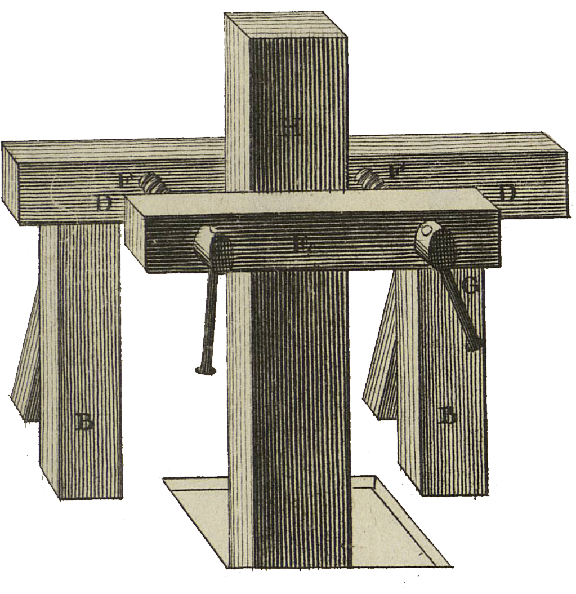

<div align="center" id="head">


<table>
<tr>
<td></td>
<td align="left">
<h1 style="margin:0">Zoteroatelier</h1>
<p style="margin:0.25em 0 0"><strong>Zotero-Bibliothek · Annotationen · KOReader</strong><br/>Plugin · API-Sync · PDF / EPUB · lokale Dateien</p>
</td>
</tr>
</table>

<a href="https://atelier.atechnologie.fr/" title="l'Atelier – Verein für Buchherstellung und Forschungswerkzeuge"></a>  
<sub>Entwickelt von <a href="https://atelier.atechnologie.fr/">l'Atelier</a> — Buchherstellung und Forschungswerkzeuge (EHESS)</sub>

<p>
🇫🇷 <a href="README.md">Français</a> ·
🇬🇧 <a href="README.en.md">English</a> ·
🇩🇪 <a href="README.de.md"><b>Deutsch</b></a> ·
🇪🇸 <a href="README.es.md">Español</a>
</p>

<p>
<a href="https://atelier.atechnologie.fr/"></a>
<a href="https://github.com/Atelier-Recherche/zoteroatelier.koplugin"></a>
</p>

</div>

---

## 📸 Vorschau

| Bibliothek | Annotationen |
| :---: | :---: |
|  |  |

---

## 📖 Über

[KOReader](https://github.com/koreader/koreader)-Plugin zum Durchsuchen Ihrer Zotero-Bibliothek, Öffnen von Anhängen, Annotieren (PDF / EPUB) und Synchronisieren der Notizen mit Zotero — auch ohne WebDAV.

> Weitergeführt als **Zotero Atelier** (Fork / Fortsetzung des Zotero-Plugins für KOReader). Beta: Fehlerberichte und PRs willkommen.

Tool-Seite: [atelier.atechnologie.fr/outil/zoteroatelier-koreader](https://atelier.atechnologie.fr/outil/zoteroatelier-koreader/)

---

## ✨ Funktionen

* Synchronisation über die Zotero-Web-API
* Öffnen von PDF- / EPUB- / HTML-Anhängen
* Bidirektionale Annotationen mit Zotero (Erstellen, Ändern, Löschen)
* Schreiben der Markierungen **in die PDF-Datei** (abschaltbar) und/oder Sync nach Zotero
* **EPUB**-Annotationen (KOReader-Sidecar ↔ Zotero; ungefähre Position / xpointers)
* Panel **Notizen des geöffneten Dokuments** (Filter, zur Seite springen, löschen)
* **Globale Suche** in den Annotationen der lokalen Bibliothek
* Automatischer Download für als „offline“ markierte Sammlungen
* **WebDAV**-Speicher (Nextcloud usw.)
* **Lokale Dateien** ohne WebDAV: Linked-Files-Ordner, externes Zotero-Storage, Pfad-Mappings, Suche nach Dateiname, Suchwurzeln
* Suche nach Einträgen über Titel und ersten Autor

### Aktuelle Einschränkungen

* Die bibliografische Suche bleibt einfach (noch keine Tags / DOI / alle Autoren)
* Bei EPUB ist die exakte CFI-Positionierung nicht immer perfekt: Text, Notiz und Seite/Kapitel haben Vorrang
* Wenn Sie sowohl das Schreiben in die PDF als auch den Zotero-Sync aktivieren, können Markierungen je nach Viewer doppelt erscheinen

---

## ⬇️ Installation

1. Verwenden Sie eine aktuelle KOReader-Version
2. Kopieren Sie den Plugin-Ordner (siehe unten — **der Name muss auf `.koplugin` enden**)
3. **KOReader vollständig beenden und neu starten** (nicht nur „Zurück“)
4. Erstellen Sie einen API-Schlüssel in den [Zotero-Einstellungen](https://www.zotero.org/settings/keys) (userID und Schlüssel notieren)
5. Bei Bedarf WebDAV konfigurieren (siehe unten)
6. Anmeldedaten im Plugin-Menü eingeben oder die Konfigurationsdatei bearbeiten

### Wohin den Plugin-Ordner kopieren

Der Ordner **muss** genau `zoteroatelier.koplugin` heißen  
(nicht `zotero.koplugin`, nicht `zoteroatelier.koplugin-master`, kein verschachtelter Ordner).

> Ein GitHub-ZIP heißt oft `zoteroatelier.koplugin-master`.  
> **Benennen Sie ihn** nach dem Entpacken in `zoteroatelier.koplugin` um.  
> KOReader ignoriert jeden Ordner, der nicht genau auf `.koplugin` endet.

Er muss **direkt** enthalten (kein Unterordner):

```
…/plugins/zoteroatelier.koplugin/
├── _meta.lua          ← erforderlich
├── main.lua           ← erforderlich
├── zoteroapi.lua
├── annotations.lua
├── annotation_panel.lua
├── annotation_search.lua
├── zoteroiteminfo.lua
└── …
```

**Falsch** (wird nicht geladen):
```
plugins/zoteroatelier.koplugin/zoteroatelier.koplugin-master/main.lua
plugins/zoteroatelier.koplugin-master/
plugins/zotero.koplugin/   ← alter Name; dieser Fork nutzt zoteroatelier
```

| Plattform | Typischer Pfad |
|-----------|----------------|
| PC / Kobo / Kindle | `<KOReader-Installation>/plugins/zoteroatelier.koplugin` |
| **Android** | `/sdcard/koreader/plugins/zoteroatelier.koplugin` |
| Alternative | `<KOReader-Datenverzeichnis>/plugins/zoteroatelier.koplugin` |

Unter Android bevorzugt `/sdcard/koreader/plugins/` (die APK ist oft schreibgeschützt).

Daten bleiben in `<KOReader-Daten>/zotero/` (Kompatibilität mit dem alten Plugin).

### Wo das Plugin in KOReader finden

Nach vollständigem Neustart:

1. Oberes Menü → **Suche** (Lupe) → **Zotero Atelier**
2. Oberes Menü → **Werkzeuge** → **Zotero Atelier**
3. Oberes Menü → **Einstellungen** (Zahnrad) → **Zotero Atelier**
4. Aktivieren: Einstellungen → **Plugin management** → **User plugins** → **Zotero Atelier** ankreuzen → neu starten

### Plugin erscheint nirgends?

1. Ordnername = genau `zoteroatelier.koplugin` (siehe oben)
2. `main.lua` und `_meta.lua` liegen im **Stamm** dieses Ordners
3. **Vollständiger** KOReader-Neustart
4. **Plugin management → User plugins**: Häkchen gesetzt (deaktiviertes altes „Zotero“ ist ein anderes Plugin)
5. Android: `/sdcard/koreader/plugins/zoteroatelier.koplugin`
6. `crash.log` (KOReader-Datenverzeichnis) öffnen und nach `zoteroatelier` / `Error when loading` suchen

---

## ✏️ Nutzung

Die meisten Metadaten bleiben lokal. Außer **Synchronize** (und dem Download einer fehlenden Datei) vermeidet das Plugin Serveraufrufe.

### Browse

Navigation in den Sammlungen. Nur Einträge mit mindestens einem unterstützten Anhang werden gelistet. Zuerst Sammlungen, dann Einträge (alphabetisch). Einträge ohne Sammlung stehen an der Wurzel.

- **Tippen:** UnterSammlung oder Anhang öffnen (Download bei Bedarf); bekannte Zotero-Annotationen werden dem Sidecar angehängt
- **Langer Druck:** Sammlung → offline; Eintrag → Bibliokarte + Anhangliste
- **Lupe:** Suche nach Titel / erstem Autor

Optionaler Gestus: Einstellungen → Gestures → General → **Zotero Collection Browser**

### Synchronize

Der erste Sync lädt alle Metadaten herunter (kann lange dauern). Danach inkrementell.

1. Lokale Annotationen senden (Erstellen / Bearbeiten / Löschen)
2. Sammlungen herunterladen
3. Einträge herunterladen / katalogisieren
4. Anhänge der Offline-Sammlungen herunterladen

### Annotationen & Notizen

Im Menü **Zotero Atelier**:

| Eintrag | Rolle |
|---------|------|
| **Document annotations** | Filterbare Liste der Notizen des geöffneten Dokuments (zur Seite, löschen) |
| **Search annotations** | Suche in allen synchronisierten Annotationen der lokalen Bibliothek |
| **Sync document annotations** | Sofortiges create/update/delete für die geöffnete Datei |
| **Write highlights into PDF files** | Schreibt Markierungen in die PDF-Datei |

Der Annotations-Sync läuft auch beim Öffnen/Schließen, wenn die Datei als Zotero-Anhang erkannt wird.

### Wartung

- **Re-analyse local items**: Anhänge / Annotationen offline neu berechnen
- **Re-scan storage**: bereits lokale Dateien indexieren
- **Resync entire collection**: lokale DB zurücksetzen und voller Resync (letzter Ausweg)

### Settings — Local files (Windows-Pfade → Android)

Zotero auf dem PC speichert oft `D:\Notes\datei.pdf`.  
Unter Android existiert dieser Pfad **nicht**. Sie brauchen:

1. **Linked files folder** = der Ordner **auf dem Gerät**, z. B.  
   `/storage/emulated/0/Documents/Notes`  
   (nicht `D:\Notes`; eine Kurzform `/Documents/Notes` wird wenn möglich erweitert)
2. **Path mapping**:  
   - From: `D:\Notes`  
   - To: `/storage/emulated/0/Documents/Notes`
3. **Enable linked files folder** aktivieren
4. Hilfemenü: **Help: Windows path → Android**

Weitere Optionen: externes Zotero-Storage, Suchwurzeln, veraltete lokale Dateien erlauben.

### API-Schlüssel prüfen

Menü → **Test Zotero API key** (oder **Save & test** nach der Kontoeingabe).  
Die User-ID ist die **Zahl** auf https://www.zotero.org/settings/keys — nicht der Benutzername.

### About/Info

Plugin-Version und Statistiken der lokalen Bibliothek.

---

## ⚙️ Konfiguration

### WebDAV

Um Anhänge außerhalb von Zotero zu speichern (z. B. Nextcloud), siehe das [Zotero-Sync-Handbuch](https://www.zotero.org/support/sync).

Die WebDAV-URL muss auf ein Verzeichnis namens `zotero` zeigen, z. B.  
`https://ihre-instanz.tld/remote.php/dav/files/ihr-user/zotero`  
Bevorzugen Sie ein App-Passwort.

### Manuelle Konfiguration

Datei `<KOReader-Daten>/zotero/meta.lua`:

```lua
return {
    ["api_key"] = "",           -- Zotero-API-Schlüssel
    ["user_id"] = "",           -- User-ID (Ganzzahl)
    ["webdav_enabled"] = false,
    ["webdav_url"] = "",
    ["webdav_user"] = "",
    ["webdav_password"] = "",
    ["prefer_local_files"] = true,
    ["linked_files_enabled"] = false,
    ["linked_files_base"] = "",
    ["external_storage_enabled"] = false,
    ["external_storage_dir"] = "",
    ["allow_stale_local"] = true,
    ["auto_disable_pdf_writing"] = false, -- false = Markierungen in die PDF schreiben
    ["path_mappings"] = {},
    ["search_roots"] = {},
}
```

### PDF: in die Datei schreiben oder nicht

Standardmäßig **aktiviert** Zotero Atelier das Schreiben von Markierungen in die PDF beim Öffnen aus dem Browser („Write highlights into PDF files“).  
Deaktivieren Sie die Option im Plugin, wenn Notizen nur im Sidecar / Zotero bleiben sollen.

Globale KOReader-Einstellung: Einstellungen → Document → Save document (write highlights into PDF).

---

## 📜 Herkunft

Basiert auf dem Community-Zotero-Plugin für KOReader und späteren Forks.  
**Zotero Atelier** — Weiterentwicklung (Annotationen, Notizen, lokale Dateien) durch [l'Atelier](https://atelier.atechnologie.fr/).

---

## 🔗 Ressourcen

| | |
| --- | --- |
| 🌐 **l'Atelier** | [atelier.atechnologie.fr](https://atelier.atechnologie.fr/) |
| 🛠️ **Tool-Seite** | [zoteroatelier-koreader](https://atelier.atechnologie.fr/outil/zoteroatelier-koreader/) |
| 📦 **Repository** | [github.com/Atelier-Recherche/zoteroatelier.koplugin](https://github.com/Atelier-Recherche/zoteroatelier.koplugin) |
| 📖 **KOReader** | [github.com/koreader/koreader](https://github.com/koreader/koreader) |
| 📚 **Zotero** | [zotero.org](https://www.zotero.org/) |

---

<div align="center">

<sub>🇫🇷 <a href="README.md">Français</a> · <a href="README.en.md">🇬🇧 English</a> · <a href="README.de.md">🇩🇪 Deutsch</a> · <a href="README.es.md">🇪🇸 Español</a> · Zoteroatelier — <a href="https://atelier.atechnologie.fr/">l'Atelier</a></sub>

</div>
