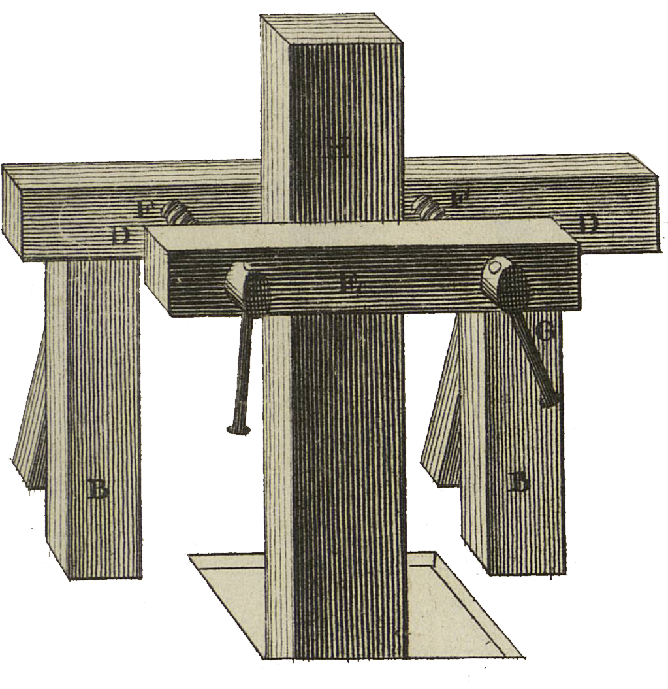

<div align="center" id="head">


<table>
<tr>
<td></td>
<td align="left">
<h1 style="margin:0">Zoteroatelier</h1>
<p style="margin:0.25em 0 0"><strong>Zotero library · Annotations · KOReader</strong><br/>Plugin · API sync · PDF / EPUB · local files</p>
</td>
</tr>
</table>

<a href="https://atelier.atechnologie.fr/" title="l'Atelier – book fabrication and research tools association"></a>  
<sub>Developed by <a href="https://atelier.atechnologie.fr/">l'Atelier</a> — book fabrication and research tools (EHESS)</sub>

<p>
🇫🇷 <a href="README.md">Français</a> ·
🇬🇧 <a href="README.en.md"><b>English</b></a> ·
🇩🇪 <a href="README.de.md">Deutsch</a> ·
🇪🇸 <a href="README.es.md">Español</a>
</p>

<p>
<a href="https://atelier.atechnologie.fr/"></a>
<a href="https://github.com/Atelier-Recherche/zoteroatelier.koplugin"></a>
</p>

</div>

---

## 📸 Preview

| Library | Annotations |
| :---: | :---: |
|  |  |

---

## 📖 About

[KOReader](https://github.com/koreader/koreader) plugin to browse your Zotero library, open attachments, annotate (PDF / EPUB), and sync notes with Zotero — including when files are not on WebDAV.

> Continued as **Zotero Atelier** (fork / continuation of the Zotero KOReader plugin). Beta: bug reports and PRs welcome.

Tool page: [atelier.atechnologie.fr/outil/zoteroatelier-koreader](https://atelier.atechnologie.fr/outil/zoteroatelier-koreader/)

---

## ✨ Features

* Sync via Zotero Web API
* Open PDF / EPUB / HTML attachments
* Bidirectional annotation sync (create, update, delete)
* Write highlights **into the PDF** (toggle) and/or sync to Zotero
* **EPUB** annotations (KOReader sidecar ↔ Zotero; approximate position / xpointers)
* **Document annotations** panel (filter, jump to page, delete)
* **Global search** across annotations in the local library
* Auto-download for offline collections
* **WebDAV** storage (Nextcloud, etc.)
* **Local files** without WebDAV: linked-files folder, external Zotero storage, path mappings, basename search, search roots
* Search entries by title and first author

### Current limitations

* Bibliographic search is still basic (no full tags / DOI / all authors yet)
* EPUB exact CFI-style positioning may be imperfect; text, note, and page/chapter sync first
* Enabling both in-PDF writing and Zotero sync can show duplicate highlights depending on the viewer

---

## ⬇️ Installation

1. Use a recent KOReader build
2. Copy the plugin folder (see below — **the name must end with `.koplugin`**)
3. **Fully quit and restart** KOReader (not just “back”)
4. Create an API key in [Zotero Settings](https://www.zotero.org/settings/keys) (note the userID and key)
5. Configure WebDAV if needed (see below)
6. Enter credentials in the plugin menu, or edit the config file

### Where to copy the plugin

The directory **must** be named exactly `zoteroatelier.koplugin`  
(not `zotero.koplugin`, not `zoteroatelier.koplugin-master`, not a nested folder).

> A GitHub ZIP is often named `zoteroatelier.koplugin-master`.  
> **Rename it** to `zoteroatelier.koplugin` after extraction.  
> KOReader ignores any folder that does not end exactly with `.koplugin`.

It must contain **directly** (not in a subfolder):

```
…/plugins/zoteroatelier.koplugin/
├── _meta.lua          ← required
├── main.lua           ← required
├── zoteroapi.lua
├── annotations.lua
├── annotation_panel.lua
├── annotation_search.lua
├── zoteroiteminfo.lua
└── …
```

**Wrong** (will not load):
```
plugins/zoteroatelier.koplugin/zoteroatelier.koplugin-master/main.lua
plugins/zoteroatelier.koplugin-master/
plugins/zotero.koplugin/   ← old name; this fork uses zoteroatelier
```

| Platform | Typical path |
|----------|----------------|
| PC / Kobo / Kindle | `<KOReader install>/plugins/zoteroatelier.koplugin` |
| **Android** | `/sdcard/koreader/plugins/zoteroatelier.koplugin` |
| Alternative | `<KOReader data directory>/plugins/zoteroatelier.koplugin` |

On Android, prefer `/sdcard/koreader/plugins/` (the APK is often read-only).

Local data stays in `<KOReader data>/zotero/` for compatibility with the previous plugin.

### Finding the plugin in KOReader

After a full restart:

1. Top menu → **Search** (magnifier) → **Zotero Atelier**
2. Top menu → **Tools** → **Zotero Atelier**
3. Top menu → **Settings** (gear) → **Zotero Atelier**
4. To enable: Settings → **Plugin management** → **User plugins** → check **Zotero Atelier** → restart

### Plugin nowhere to be found?

1. Folder name = exactly `zoteroatelier.koplugin` (see above)
2. `main.lua` and `_meta.lua` are at the **root** of that folder
3. **Full** KOReader restart
4. **Plugin management → User plugins**: box checked (disabling the old “Zotero” plugin is unrelated)
5. Android: `/sdcard/koreader/plugins/zoteroatelier.koplugin`
6. Open `crash.log` (KOReader data directory) and search for `zoteroatelier` / `Error when loading`

---

## ✏️ Usage

Most library metadata stays on device. Apart from **Synchronize** (and downloading a missing file), the plugin avoids hitting the Zotero server.

### Browse

Navigate collections. Only items with at least one supported attachment are listed. Collections first, then items (alphabetical). Items without a collection appear at the root.

- **Tap:** open a sub-collection or attachment (download if needed); known Zotero annotations are attached to the sidecar
- **Long-press:** collection → offline; item → bibliographic card + attachment list
- **Magnifier:** search by title / first author

Optional gesture: Settings → Gestures → General → **Zotero Collection Browser**

### Synchronize

The first sync downloads all metadata (can take a while). Afterwards, sync is incremental.

1. Upload local annotations (create / update / delete)
2. Download collections
3. Download / catalogue items
4. Download attachments for offline collections

### Annotations & notes

In the **Zotero Atelier** menu:

| Menu item | Role |
|-----------|------|
| **Document annotations** | Filterable list for the open document (jump to page, delete) |
| **Search annotations** | Search all synced annotations in the local library |
| **Sync document annotations** | Immediate create/update/delete for the open file |
| **Write highlights into PDF files** | Enable writing highlights into the PDF file |

Annotation sync also runs on open/close when the file matches a Zotero attachment.

### Maintenance

- **Re-analyse local items**: recalculate attachments / annotations offline
- **Re-scan storage**: index files already present locally
- **Resync entire collection**: wipe the local DB then full resync (last resort)

### Settings — Local files (Windows paths → Android)

Zotero on a PC often stores `D:\Notes\file.pdf`.  
On Android that path **does not exist**. You need:

1. **Linked files folder** = the folder **on the device**, e.g.  
   `/storage/emulated/0/Documents/Notes`  
   (not `D:\Notes`; a shortcut like `/Documents/Notes` is expanded when possible)
2. **Path mapping**:  
   - From: `D:\Notes`  
   - To: `/storage/emulated/0/Documents/Notes`
3. Enable **Enable linked files folder**
4. Help menu: **Help: Windows path → Android**

Other options: external Zotero storage, search roots, allow outdated local files.

### Verify the API key

Menu → **Test Zotero API key** (or **Save & test** after entering the account).  
The User ID is the **number** shown at https://www.zotero.org/settings/keys — not the username.

### About/Info

Plugin version and local library statistics.

---

## ⚙️ Configuration

### WebDAV

To store attachments outside Zotero storage (e.g. Nextcloud), see the [Zotero sync manual](https://www.zotero.org/support/sync).

The WebDAV URL must point to a directory named `zotero`, e.g.  
`https://your-instance.tld/remote.php/dav/files/your-user/zotero`  
Prefer an app password.

### Manual configuration

File `<KOReader data>/zotero/meta.lua`:

```lua
return {
    ["api_key"] = "",           -- Zotero API key
    ["user_id"] = "",           -- user ID (integer)
    ["webdav_enabled"] = false,
    ["webdav_url"] = "",
    ["webdav_user"] = "",
    ["webdav_password"] = "",
    ["prefer_local_files"] = true,
    ["linked_files_enabled"] = false,
    ["linked_files_base"] = "",
    ["external_storage_enabled"] = false,
    ["external_storage_dir"] = "",
    ["allow_stale_local"] = true,
    ["auto_disable_pdf_writing"] = false, -- false = write highlights into the PDF
    ["path_mappings"] = {},
    ["search_roots"] = {},
}
```

### PDF: write into the file or not

By default, Zotero Atelier **enables** writing highlights into the PDF when opening from the browser (“Write highlights into PDF files”).  
Turn that off in the plugin if you prefer notes only in the sidecar / Zotero.

Global KOReader setting: Settings → Document → Save document (write highlights into PDF).

---

## 📜 Provenance

Based on the community Zotero KOReader plugin and subsequent forks.  
**Zotero Atelier** — continued development (annotations, notes, local files) by [l'Atelier](https://atelier.atechnologie.fr/).

---

## 🔗 Resources

| | |
| --- | --- |
| 🌐 **l'Atelier** | [atelier.atechnologie.fr](https://atelier.atechnologie.fr/) |
| 🛠️ **Tool page** | [zoteroatelier-koreader](https://atelier.atechnologie.fr/outil/zoteroatelier-koreader/) |
| 📦 **Repository** | [github.com/Atelier-Recherche/zoteroatelier.koplugin](https://github.com/Atelier-Recherche/zoteroatelier.koplugin) |
| 📖 **KOReader** | [github.com/koreader/koreader](https://github.com/koreader/koreader) |
| 📚 **Zotero** | [zotero.org](https://www.zotero.org/) |

---

<div align="center">

<sub>🇫🇷 <a href="README.md">Français</a> · <a href="README.en.md">🇬🇧 English</a> · <a href="README.de.md">🇩🇪 Deutsch</a> · <a href="README.es.md">🇪🇸 Español</a> · Zoteroatelier — <a href="https://atelier.atechnologie.fr/">l'Atelier</a></sub>

</div>
