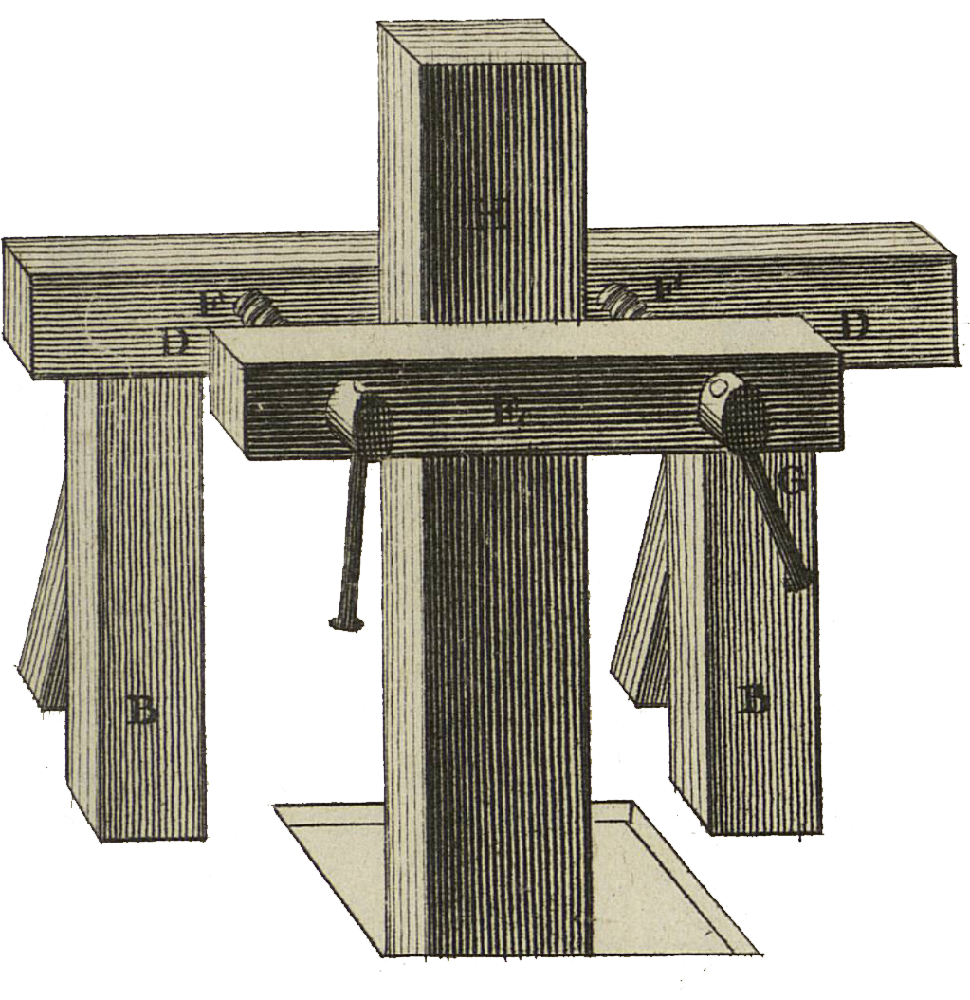

<div align="center" id="head">


<table>
<tr>
<td></td>
<td align="left">
<h1 style="margin:0">Zoteroatelier</h1>
<p style="margin:0.25em 0 0"><strong>Biblioteca Zotero · Anotaciones · KOReader</strong><br/>Plugin · sync API · PDF / EPUB · archivos locales</p>
</td>
</tr>
</table>

<a href="https://atelier.atechnologie.fr/" title="l'Atelier – asociación de fabricación de libros y herramientas de investigación"></a>  
<sub>Desarrollado por <a href="https://atelier.atechnologie.fr/">l'Atelier</a> — fabricación de libros y herramientas de investigación (EHESS)</sub>

<p>
🇫🇷 <a href="README.md">Français</a> ·
🇬🇧 <a href="README.en.md">English</a> ·
🇩🇪 <a href="README.de.md">Deutsch</a> ·
🇪🇸 <a href="README.es.md"><b>Español</b></a>
</p>

<p>
<a href="https://atelier.atechnologie.fr/"></a>
<a href="https://github.com/Atelier-Recherche/zoteroatelier.koplugin"></a>
</p>

</div>

---

## 📸 Vista previa

| Biblioteca | Anotaciones |
| :---: | :---: |
|  |  |

---

## 📖 Acerca de

Plugin para [KOReader](https://github.com/koreader/koreader) para explorar su biblioteca Zotero, abrir adjuntos, anotar (PDF / EPUB) y sincronizar las notas con Zotero — incluso fuera de WebDAV.

> Continuado como **Zotero Atelier** (fork / continuación del plugin Zotero para KOReader). Beta: se agradecen informes de errores y PRs.

Página de la herramienta: [atelier.atechnologie.fr/outil/zoteroatelier-koreader](https://atelier.atechnologie.fr/outil/zoteroatelier-koreader/)

---

## ✨ Funciones

* Sincronización mediante la API Web de Zotero
* Apertura de adjuntos PDF / EPUB / HTML
* Anotaciones bidireccionales con Zotero (crear, modificar, eliminar)
* Escritura de resaltados **en el PDF** (opción activable) y/o sync hacia Zotero
* Anotaciones **EPUB** (sidecar KOReader ↔ Zotero; posición aproximada / xpointers)
* Panel de **notas del documento abierto** (filtro, ir a la página, eliminar)
* **Búsqueda global** en las anotaciones de la biblioteca local
* Descarga automática de colecciones marcadas como « offline »
* Almacenamiento **WebDAV** (Nextcloud, etc.)
* **Archivos locales** sin WebDAV: carpeta linked files, storage Zotero externo, mapeos de rutas, búsqueda por nombre de archivo, raíces de búsqueda
* Búsqueda de entradas por título y primer autor

### Limitaciones actuales

* La búsqueda bibliográfica sigue siendo básica (aún sin tags / DOI / todos los autores)
* En EPUB, el posicionamiento exacto tipo CFI de Zotero no siempre es perfecto: se priorizan texto, nota y página/capítulo
* Si activa a la vez la escritura en el PDF y el sync Zotero, los resaltados pueden duplicarse según el visor

---

## ⬇️ Instalación

1. Use una versión reciente de KOReader
2. Copie la carpeta del plugin (véase abajo — **el nombre debe terminar en `.koplugin`**)
3. **Salga completamente y reinicie** KOReader (no solo « volver »)
4. Cree una clave API en los [ajustes de Zotero](https://www.zotero.org/settings/keys) (anote el userID y la clave)
5. Si hace falta, configure WebDAV (véase más abajo)
6. Introduzca las credenciales en el menú del plugin, o edite el archivo de configuración

### Dónde copiar el plugin

La carpeta **debe** llamarse exactamente `zoteroatelier.koplugin`  
(no `zotero.koplugin`, no `zoteroatelier.koplugin-master`, no una carpeta anidada).

> Un ZIP de GitHub suele llamarse `zoteroatelier.koplugin-master`.  
> **Renómbrelo** a `zoteroatelier.koplugin` tras extraerlo.  
> KOReader ignora cualquier carpeta que no termine exactamente en `.koplugin`.

Debe contener **directamente** (sin subcarpeta):

```
…/plugins/zoteroatelier.koplugin/
├── _meta.lua          ← obligatorio
├── main.lua           ← obligatorio
├── zoteroapi.lua
├── annotations.lua
├── annotation_panel.lua
├── annotation_search.lua
├── zoteroiteminfo.lua
└── …
```

**Incorrecto** (no carga):
```
plugins/zoteroatelier.koplugin/zoteroatelier.koplugin-master/main.lua
plugins/zoteroatelier.koplugin-master/
plugins/zotero.koplugin/   ← nombre antiguo; este fork usa zoteroatelier
```

| Plataforma | Ruta típica |
|------------|-------------|
| PC / Kobo / Kindle | `<instalación KOReader>/plugins/zoteroatelier.koplugin` |
| **Android** | `/sdcard/koreader/plugins/zoteroatelier.koplugin` |
| Alternativa | `<directorio de datos KOReader>/plugins/zoteroatelier.koplugin` |

En Android, prefiera `/sdcard/koreader/plugins/` (el APK suele ser de solo lectura).

Los datos permanecen en `<datos KOReader>/zotero/` (compatibilidad con el plugin anterior).

### Dónde encontrar el plugin en KOReader

Tras un reinicio completo:

1. Menú superior → **Buscar** (lupa) → **Zotero Atelier**
2. Menú superior → **Herramientas** → **Zotero Atelier**
3. Menú superior → **Ajustes** (engranaje) → **Zotero Atelier**
4. Para activarlo: Ajustes → **Plugin management** → **User plugins** → marque **Zotero Atelier** → reiniciar

### ¿El plugin no aparece en ninguna parte?

1. Carpeta = exactamente `zoteroatelier.koplugin` (véase arriba)
2. `main.lua` y `_meta.lua` están en la **raíz** de esa carpeta
3. Reinicio **completo** de KOReader
4. **Plugin management → User plugins**: casilla marcada (desactivar el « Zotero » antiguo no es lo mismo)
5. Android: `/sdcard/koreader/plugins/zoteroatelier.koplugin`
6. Abra `crash.log` (directorio de datos KOReader) y busque `zoteroatelier` / `Error when loading`

---

## ✏️ Uso

El plugin conserva la mayoría de metadatos en local. Salvo **Synchronize** (y la descarga de un archivo faltante), evita llamar al servidor.

### Browse

Navegación por colecciones. Solo se listan ítems con al menos un adjunto compatible. Primero colecciones, luego ítems (orden alfabético). Los ítems sin colección están en la raíz.

- **Toque:** abrir una subcolección o un adjunto (descarga si hace falta); las anotaciones Zotero conocidas se adjuntan al sidecar
- **Pulsación larga:** colección → offline; ítem → ficha bibliográfica + lista de adjuntos
- **Lupa:** búsqueda por título / primer autor

Gesto opcional: Ajustes → Gestures → General → **Zotero Collection Browser**

### Synchronize

La primera sync descarga todos los metadatos (puede tardar). Después, sync incremental.

1. Envío de anotaciones locales (crear / editar / eliminar)
2. Descarga de colecciones
3. Descarga / catálogo de ítems
4. Descarga de adjuntos de las colecciones offline

### Anotaciones y notas

En el menú **Zotero Atelier**:

| Entrada | Función |
|---------|---------|
| **Document annotations** | Lista filtrable de notas del documento abierto (ir a la página, eliminar) |
| **Search annotations** | Búsqueda en las anotaciones de toda la biblio sincronizada |
| **Sync document annotations** | Envío inmediato create/update/delete para el archivo abierto |
| **Write highlights into PDF files** | Activa la escritura de resaltados en el archivo PDF |

La sync de anotaciones también se dispara al abrir y cerrar un documento reconocido como adjunto Zotero.

### Mantenimiento

- **Re-analyse local items**: recalcula adjuntos / anotaciones sin red
- **Re-scan storage**: indexa archivos ya presentes localmente
- **Resync entire collection**: pone a cero la base local y hace resync completa (último recurso)

### Settings — Local files (rutas Windows → Android)

Zotero en PC suele guardar `D:\Notes\archivo.pdf`.  
En Android esa ruta **no existe**. Hay que:

1. **Linked files folder** = la carpeta **en el dispositivo**, p. ej.  
   `/storage/emulated/0/Documents/Notes`  
   (no `D:\Notes`; un atajo `/Documents/Notes` se amplía si es posible)
2. **Path mapping**:  
   - From: `D:\Notes`  
   - To: `/storage/emulated/0/Documents/Notes`
3. Activar **Enable linked files folder**
4. Menú de ayuda: **Help: Windows path → Android**

Otras opciones: storage Zotero externo, raíces de búsqueda, permitir archivos locales desactualizados.

### Verificar la clave API

Menú → **Test Zotero API key** (o **Save & test** tras introducir la cuenta).  
El User ID es el **número** mostrado en https://www.zotero.org/settings/keys — no el nombre de usuario.

### About/Info

Versión del plugin y estadísticas de la biblioteca local.

---

## ⚙️ Configuración

### WebDAV

Para almacenar adjuntos fuera de Zotero (p. ej. Nextcloud), consulte el [manual de sync de Zotero](https://www.zotero.org/support/sync).

La URL WebDAV debe apuntar a un directorio llamado `zotero`, p. ej.  
`https://su-instancia.tld/remote.php/dav/files/su-usuario/zotero`  
Prefiera una contraseña de aplicación.

### Configuración manual

Archivo `<datos KOReader>/zotero/meta.lua`:

```lua
return {
    ["api_key"] = "",           -- clave API Zotero
    ["user_id"] = "",           -- user ID (entero)
    ["webdav_enabled"] = false,
    ["webdav_url"] = "",
    ["webdav_user"] = "",
    ["webdav_password"] = "",
    ["prefer_local_files"] = true,
    ["linked_files_enabled"] = false,
    ["linked_files_base"] = "",
    ["external_storage_enabled"] = false,
    ["external_storage_dir"] = "",
    ["allow_stale_local"] = true,
    ["auto_disable_pdf_writing"] = false, -- false = escribir resaltados en el PDF
    ["path_mappings"] = {},
    ["search_roots"] = {},
}
```

### PDF: escribir o no en el archivo

Por defecto, Zotero Atelier **activa** la escritura de resaltados en el PDF al abrir desde el navegador (« Write highlights into PDF files »).  
Desactive la opción en el plugin si prefiere mantener las notas solo en el sidecar / Zotero.

Ajuste global de KOReader: Ajustes → Document → Save document (write highlights into PDF).

---

## 📜 Procedencia

Basado en el plugin Zotero para KOReader de la comunidad y forks sucesivos.  
**Zotero Atelier** — continuación y extensiones (anotaciones, notas, archivos locales) por [l'Atelier](https://atelier.atechnologie.fr/).

---

## 🔗 Recursos

| | |
| --- | --- |
| 🌐 **l'Atelier** | [atelier.atechnologie.fr](https://atelier.atechnologie.fr/) |
| 🛠️ **Página de la herramienta** | [zoteroatelier-koreader](https://atelier.atechnologie.fr/outil/zoteroatelier-koreader/) |
| 📦 **Repositorio** | [github.com/Atelier-Recherche/zoteroatelier.koplugin](https://github.com/Atelier-Recherche/zoteroatelier.koplugin) |
| 📖 **KOReader** | [github.com/koreader/koreader](https://github.com/koreader/koreader) |
| 📚 **Zotero** | [zotero.org](https://www.zotero.org/) |

---

<div align="center">

<sub>🇫🇷 <a href="README.md">Français</a> · <a href="README.en.md">🇬🇧 English</a> · <a href="README.de.md">🇩🇪 Deutsch</a> · <a href="README.es.md">🇪🇸 Español</a> · Zoteroatelier — <a href="https://atelier.atechnologie.fr/">l'Atelier</a></sub>

</div>
